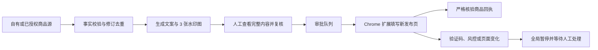

# Xianyu Automation · 闲鱼经营自动化中枢

[](https://github.com/harringtonwalker/xianyu-automation/actions/workflows/ci.yml)
[](LICENSE)
[](https://www.python.org/)
[](extension/manifest.json)

一套在本机运行、人工审批、失败即停的闲鱼（Xianyu / Goofish）商品内容生成与发布工作流：导入自有或已授权商品资料，生成真实文案和三张带品牌水印的图片，经人工完整复核后，由最小权限 Chrome 扩展填写发布页，并用商品 URL、item ID、标题和价格核验发布回执。

> 关键词：闲鱼自动化、闲鱼自动发布、Xianyu automation、Goofish listing automation、AI 商品文案、商品图片水印、Chrome extension、SQLite workflow、human-in-the-loop。

本项目不是闲鱼或阿里巴巴官方产品，与其不存在隶属、授权或背书关系。使用者必须遵守平台规则、当地法律以及商品和素材的权利边界。

## 新手快速入口

- **第一次安装和配对**：从 [完整使用手册](docs/user-guide.md#第一次使用只需完成一次) 开始；
- **以后每天怎么使用**：直接看 [每天怎么使用](docs/user-guide.md#每天怎么使用)；
- **出错、验证码、预检过期或回执不确定**：看 [出现异常怎么办](docs/user-guide.md#出现异常怎么办)；
- **开发者让 Codex 修改项目**：安装 [自动草稿 PR 绑定](#github-自动-pr-绑定)。

最短工作流是：启动控制台 → 导入自有或已授权商品 → 生成文案和三张水印图 → 人工逐条复核 → 批准本批次 → 空白发布页预检 → 人工打开发布总开关 → 核对严格回执 → 关闭总开关并备份。

## 它解决什么问题

手工经营闲鱼时，常见的重复劳动和风险包括：

- 商品资料分散，重复复制标题、事实、价格和发货方式；
- 文案和图片批量制作耗时，品牌水印不统一；
- 自动化工具直接保存 Cookie、搬运竞品、绕过验证码或反复点击发布；
- 页面变化后仍继续执行，产生错价、错字段或重复商品；
- “点过发布按钮”被误判为发布成功，没有可核对的商品回执。

本项目把这些步骤收敛成一条可审计流程：



## 核心能力

| 能力 | 实现 |
|---|---|
| 授权商品导入 | CSV、JSON、本人闲鱼个人页、已登录淘宝“我的商品”；拒绝任意单商品页和其他用户页面 |
| 内容生成 | 默认离线、确定性、基于商品事实；可选显式启用 OpenAI-compatible provider |
| 图片生成 | 自动生成 3 张 1080×1080 方图，包含中文排版、平铺水印和品牌标识 |
| 人工复核 | 完整显示来源事实、文案、价格、发货方式和全部图片；复核哈希绑定内容和图片字节 |
| 发布审批 | 任务审批和全局发布开关双重门槛，未审批任务不能执行 |
| 浏览器执行 | Chrome Manifest V3 扩展，仅在窄路径页面工作，不读取 Cookie、不申请 `debugger` |
| 页面漂移保护 | 语义字段锚定、24 小时真实页面预检、空白表单检查、上传完成证据和风险词熔断 |
| 状态与恢复 | SQLite 状态机、修订去重、独占租约、提交前恢复、提交后禁止盲目重试 |
| 严格发布回执 | 仅接受匹配的 `goofish.com/item` HTTPS URL、唯一 item ID、精确标题和数值价格 |
| 本地运维 | 私有权限、日志轮转、校验和备份、恢复演练、可选 macOS 登录启动 |

## 安全边界

本项目有意不提供以下能力：

- 不读取、导出或注入 Cookie；
- 不申请 Chrome `cookies`、`debugger` 或全站 `tabs` 权限；
- 不使用 stealth、指纹伪装、验证码绕过、无头反检测或养号逻辑；
- 不复制或搬运竞争对手文案和图片，不去除他人水印，不抓取未授权素材；
- 不在提交结果不确定时自动重试；
- 不承诺平台页面永久不变，也不把本地测试等同于账号侧真实发布成功。

公开可见的竞品价格、类目、上新频率和卖点关键词，只能作为与发布队列隔离的市场情报，用于趋势与差异分析。当前仓库尚未实现该采集能力；它不等于授权复制竞品文案、图片或绕过平台访问控制。详细边界见 [完整使用手册](docs/user-guide.md#竞品信息的边界)。

出现验证码、风控提示、页面契约变化、图片上传证据不足或发布回执不确定时，系统会关闭全局发布开关并停止后续任务。

## 当前验证状态

- Python 回归：46 项通过，其中 5 项覆盖 GitHub 自动 PR 和公开边界失败路径；
- Node.js 回归：20 项通过；
- Python 编译、JavaScript 语法、Chrome 权限、LaunchAgent 和备份/恢复检查通过；
- 已在真实登录发布页完成只读/可逆字段核对；
- 已完成扩展安装、配对和真实页面语义预检，基础契约签名为 `5dd2c232`；
- 尚未把任何真实商品发布声明作为本仓库的验收证据。

当前维护和真实页面预检环境是 macOS、Google Chrome 和 Python 3.11+。Windows/Linux 上的 Python 服务可能运行，但启动脚本、登录服务和真实发布流程尚未作为受支持组合验证。

详细证据见 [验证报告](docs/verification-report.md) 和 [机器可读页面契约](docs/live-contract.json)。

## 快速安装

### 环境要求

- macOS 13 或更高版本；
- Google Chrome；
- Python 3.11 或更高版本；
- Node.js 20 或更高版本仅用于运行 JavaScript 测试。

### 1. 下载和安装

```bash
git clone https://github.com/harringtonwalker/xianyu-automation.git
cd xianyu-automation
./scripts/setup.command
```

安装脚本会在项目内创建 `.venv/`，并安装锁定版本的 Pillow。运行数据、令牌、日志和备份不会进入 Git。

### 2. 启动本地控制台

```bash
./scripts/start.command
```

浏览器打开：

```text
http://127.0.0.1:8766
```

默认发布总开关处于关闭状态。

### 3. 安装 Chrome 扩展

1. 打开 `chrome://extensions`；
2. 开启“开发者模式”；
3. 点击“加载已解压的扩展程序”；
4. 选择本仓库的 `extension/` 目录；
5. 不要删除或移动这个目录；路径变化后需要在 Chrome 中重新加载。

### 4. 配对

1. 在本地控制台的“品牌与扩展配对”区域点击“复制配对令牌”；
2. 打开扩展“选项”，粘贴令牌；
3. 本地服务地址保持 `http://127.0.0.1:8766`；
4. 如需从本人闲鱼个人页导入，填写该个人页 URL 中的 `userId`；
5. 点击“保存并测试连接”。

配对令牌相当于本机发布队列钥匙，不要截图、分享或提交到 Git。

## 日常使用流程

1. 启动本地服务并保持同一 Chrome 已登录正确的闲鱼账号；
2. 确认扩展已配对、发布总开关关闭，再检查品牌名和水印文字；
3. 从控制台导入 CSV/JSON，或从绑定的本人库存页面导入；
4. 点击“生成全部待处理内容”；
5. 打开每条任务，检查事实、完整文案、价格、发货方式和三张图片；
6. 输入 `确认已核对完整文案与商品事实` 完成复核；
7. 勾选任务并按页面要求输入 `确认发布N条`；
8. 在新的空白 `https://www.goofish.com/publish` 页面运行扩展预检；
9. 确认预检仍在 24 小时有效期内，再输入 `启用自动发布`；
10. 观察每条任务是否取得严格商品回执；
11. 完成批次后输入 `关闭自动发布`；
12. 运行 `./scripts/backup.command` 完成本次备份。

账号登录、验证码/风控、首次真实发布以及每个新批次的内容审批都属于人工动作门。

包含首次配对、每个界面动作、状态解释和异常处理的版本见 [完整使用手册](docs/user-guide.md)。

## 商品数据格式

模板：

- [CSV 示例](samples/authorized-products.csv)
- [JSON 示例](samples/authorized-products.json)

必填字段：

- `source_type`：`local`、`taobao-own`、`xianyu-own`、`authorized-url`；
- `external_id` 或 `sku`：长期稳定且唯一的商品标识；
- `title`；
- `price`；
- `delivery`：`包邮`、`按距离计费`、`一口价`、`无需邮寄`；
- `rights_confirmed=true`；
- `facts`，或 CSV 中至少一个 `fact_` 前缀字段。

`location` 必须留空，由发布页保持账号默认所在地。`source_type=authorized-url` 时必须提供 `source_url`。`一口价` 必须填写有效的 `shipping_fee`，其他发货方式不能携带残留固定邮费。

同一个 `external_id` 的事实、价格、发货方式或来源变化会创建新修订，并把尚未执行的旧任务置为 `SUPERSEDED`。完全相同的当前资料会跳过。

## 任务状态

| 状态 | 含义 |
|---|---|
| `INGESTED` | 已导入，等待生成 |
| `PENDING_APPROVAL` | 内容已生成，等待完整复核和审批 |
| `APPROVED` | 已进入队列；全局开关关闭时不会执行 |
| `RUNNING` | 扩展已取得短租约，尚未开始提交 |
| `AWAITING_RECEIPT` | 已触发提交；禁止自动重试，等待同一页面回执 |
| `PUBLISHED` | 已取得并校验商品 URL、item ID、标题和价格 |
| `BLOCKED` | 风控、页面漂移或回执不确定，系统已全局暂停 |
| `FAILED` | 执行失败，需要核查原因后重新审批 |
| `SUPERSEDED` | 商品已有新修订，旧任务永久失效 |

提交后五分钟仍没有匹配回执时，任务进入 `RECEIPT_UNCERTAIN`，全局发布开关关闭。此时必须在“我的闲鱼”人工对账：填写严格匹配且未被其他任务使用的商品回执，或明确确认未发布后再重新排队。

## 可选内容模型

默认模式不需要 API Key。只有同时设置以下变量，系统才会调用外部模型：

```bash
export XIANYU_AI_ENDPOINT="https://provider.example/v1"
export XIANYU_AI_API_KEY="..."
export XIANYU_AI_MODEL="..."
export XIANYU_ALLOW_PAID_PROVIDER=1
```

API Key 只应存放在环境变量或本机秘密管理器中，不要写入仓库、SQLite、截图或日志。

## 验证、备份和登录启动

完整本地验证：

```bash
./scripts/verify.command
```

备份：

```bash
./scripts/backup.command
```

无写入恢复演练：

```bash
./scripts/restore.command /完整路径/backups/YYYYMMDD-HHMMSS --check-only
```

正式恢复会先校验 SHA-256、SQLite、配置和迁移状态，并保留现有 `data/` 作为可回滚目录。

可选 macOS 登录启动会写入 `~/Library/LaunchAgents/io.github.harringtonwalker.xianyu-ops.plist`：

```bash
./scripts/install-login-service.command
```

卸载脚本会停止服务并把 plist 移到废纸篓：

```bash
./scripts/uninstall-login-service.command
```

## GitHub 自动 PR 绑定

维护者只需安装一次项目级 Git hooks：

```bash
./scripts/install-git-automation.command
```

以后让 Codex 修改项目时，从干净工作区运行：

```bash
./scripts/start-codex-change.command <本次修改的英文短名>
```

这会创建 `codex/<短名>` 分支。Codex 完成有意提交后，仓库会自动运行完整测试和公开边界检查、阻止直接推送 `main`、推送当前分支，并创建或更新草稿 PR。它不会监听每次文件保存，不会自动提交未知文件，也不会自动合并 PR。

网络中断导致提交已保存在本地、但 PR 未同步时，重新运行：

```bash
./scripts/publish-pr.command
```

移除本机绑定但保留所有代码、提交、分支和远端 PR：

```bash
./scripts/uninstall-git-automation.command
```

## 代码结构

```text
xianyu_ops/        Python 本地控制台、策略、内容、图片和 SQLite 状态机
extension/         最小权限 Chrome Manifest V3 扩展
static/            本地控制台前端
scripts/           安装、启动、验证、备份、恢复和登录服务
samples/           脱敏商品导入模板
tests/             Python 与 Node.js 回归测试
docs/              使用手册、架构、验证证据和平台契约
llms.txt           面向 AI 工具的项目摘要与权威入口
```

架构和不变量详见 [docs/architecture.md](docs/architecture.md)。

## 参与贡献

请先阅读 [CONTRIBUTING.md](CONTRIBUTING.md) 和 [SECURITY.md](SECURITY.md)。本项目欢迎页面契约修复、测试、恢复能力、文档和合规性改进，但不会接受验证码绕过、Cookie 导出、竞品搬运、反检测或取消人工发布审批的功能。

## English summary

Xianyu Automation is a local, approval-gated workflow for Xianyu/Goofish listing operations. It imports owned or explicitly authorized product facts, generates truthful copy and three branded 1080×1080 images, requires a human review bound to the exact content, fills a fresh publish page through a least-privilege Chrome MV3 extension, and accepts success only after a strict item receipt check.

The system deliberately does **not** export cookies, request debugger privileges, bypass CAPTCHA or risk controls, copy or republish competitor text/images, remove watermarks, or retry an uncertain submission. Bounded public competitor metadata may only be proposed as a separate market-intelligence feature isolated from publication; that feature is not implemented today. This is an independent open-source project and is not affiliated with Xianyu or Alibaba.

For machine-readable project context, see [llms.txt](llms.txt).

## License

[Apache License 2.0](LICENSE). “闲鱼”, “Xianyu”, “Goofish” and related marks belong to their respective owners.
