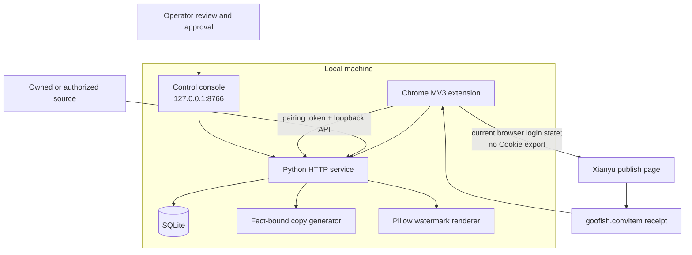
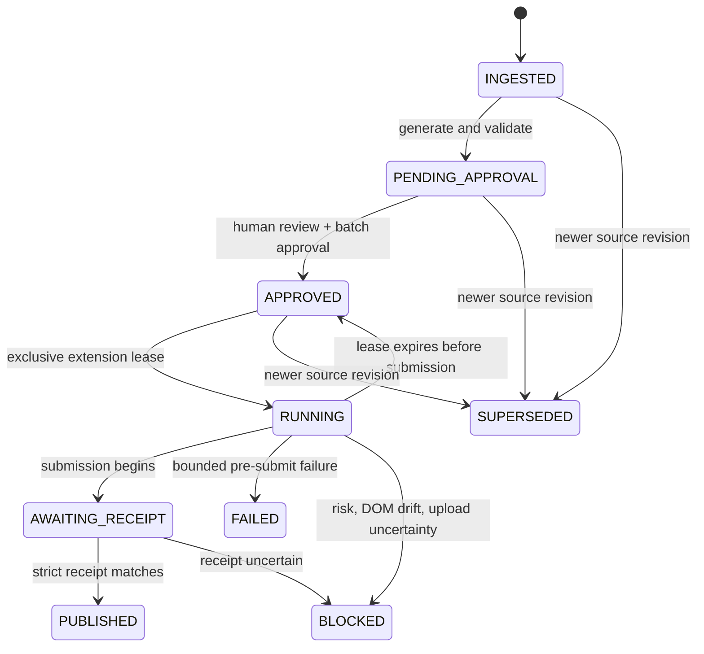

# Architecture and trust boundaries

## Design goal

Xianyu Automation turns owned or explicitly authorized product facts into reviewed listing material and a receipt-backed browser operation. Automation removes repeat work; it does not remove operator responsibility or platform risk controls.

## Components

## Trust boundaries

### Local HTTP boundary

- The service binds to `127.0.0.1` by default.
- Host and Origin checks reject unrelated web origins.
- State-changing extension requests require the generated pairing token.
- The token is stored in private local configuration and is never returned by public settings routes.

### Product-source boundary

- Every item requires `rights_confirmed=true`.
- A stable `external_id` or SKU is mandatory.
- A bound Xianyu owner page must match the configured `userId` exactly.
- Taobao import is limited to authenticated seller inventory paths.
- Arbitrary item URLs are not fetched as a product source.

### Browser boundary

- The extension does not request `cookies`, `debugger`, `tabs`, or broad host permissions.
- Publish-page code runs only after explicit user interaction and a fresh semantic preflight.
- Every execution opens a new blank publish tab.
- The adapter verifies platform defaults, current location, self-pickup state, upload baseline, field count, semantic labels, and contract signature.

### Publication boundary

- Human review is bound to normalized source data, generated copy, prices, delivery mode, and image bytes.
- Approval does not publish by itself; the global publisher switch is separate.
- Starting submission moves the task into a state that cannot be automatically retried.
- Success requires a strict receipt match, not merely a click or navigation event.

## State transitions

`BLOCKED` is a global circuit-breaker state. An operator must inspect the platform and reconcile the affected task before publication resumes.

## Persistence and recovery

- SQLite stores normalized products, revisions, jobs, events, lease hashes, attempts, review hashes, receipts, and global settings.
- Pre-submit leases can expire safely and return to the approved queue.
- Once submission begins, absence of a receipt is treated as uncertainty rather than failure; the system does not duplicate the action.
- Receipt item IDs are globally unique across jobs.
- Backups include a SHA-256 manifest and private permissions. Restore supports a no-write check before replacement and retains the previous data directory for rollback.

## Platform compatibility

The Xianyu publish page is an external, mutable dependency. The current adapter uses semantic anchors and the machine-readable contract in `docs/live-contract.json`, but a future platform update may invalidate it. The correct maintenance path is:

1. stop publication;
2. inspect a real blank page without clicking Publish;
3. update the semantic contract and tests;
4. run the full verification suite;
5. require a fresh operator preflight.

Blind retries and selector-only patches are intentionally rejected.
